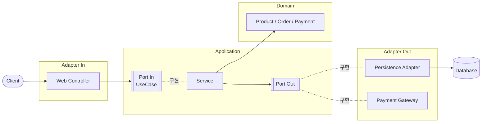
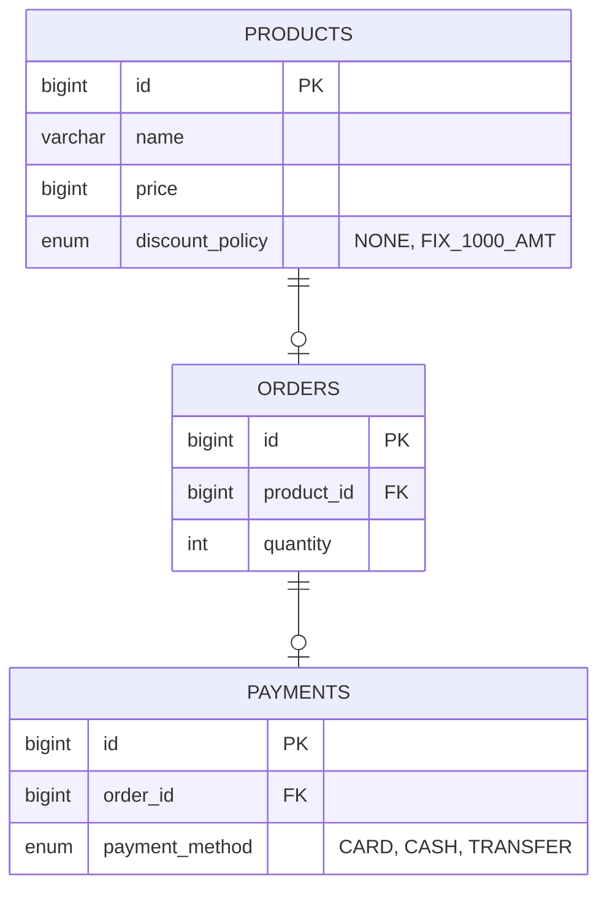

# Product Order Service

> 헥사고날 아키텍처로 설계한 상품 · 주문 · 결제 API 서버
>
> 대규모 이벤트 상황에서 **재고 정합성**과 **상품 조회 성능**을 보장하는 주문 서비스

<br>

## 목차

- [기술 스택](#기술-스택)
- [아키텍처](#아키텍처)
- [ERD](#erd)
- [API](#api)
- [기술적 고민과 해결](#기술적-고민과-해결)
- [테스트 전략](#테스트-전략)
- [실행 방법](#실행-방법)
- [로드맵](#로드맵)

<br>

## 기술 스택

| 구분 | 사용 기술 |
|---|---|
| Language | Java 17 |
| Framework | Spring Boot 4.1, Spring Web MVC |
| Persistence | Spring Data JPA, H2 |
| Test | JUnit 5, AssertJ, RestAssured, MockMvc |
| API Docs | Spring REST Docs, restdocs-api-spec (OpenAPI 3), Scalar |
| Build · CI | Gradle, GitHub Actions, GitHub Pages |

<br>

## 아키텍처

### 헥사고날 아키텍처 (Ports & Adapters)



- **의존 방향은 항상 바깥 → 안쪽**입니다. Controller는 Service 구현체가 아니라 `UseCase` 인터페이스에, Service는 JPA Repository가 아니라 `Port Out` 인터페이스에 의존합니다.
- **application 계층은 Spring Data 타입을 모릅니다.** 페이징의 `PageRequest`, `Sort` 등은 Persistence Adapter 내부에서만 사용합니다.

### 패키지 구조

각 도메인(`product`, `order`, `payment`)은 동일한 구조를 가집니다.

```
product
├── adapter
│   ├── in/web                 # Controller, Response DTO
│   └── out/persistence        # Port Out 구현체, JPA Repository
├── application
│   ├── port/in                # UseCase 인터페이스, Request DTO
│   ├── port/out               # Port Out 인터페이스
│   └── service                # UseCase 구현체
└── domain                     # Entity, 도메인 규칙
common                         # 공통 예외, 예외 응답 처리
```

<br>

## ERD



<br>

## API

📄 **[API 문서](https://yoonxjoong.github.io/product-order-service/)** · 문서화 테스트로 생성되어 main 반영 시 자동 배포됩니다.

| Method | URI | 설명 | 성공 응답 |
|---|---|---|---|
| `POST` | `/products` | 상품 등록 | `201 Created` |
| `GET` | `/products/{productId}` | 상품 단건 조회 | `200 OK` |
| `GET` | `/products?page={page}&size={size}` | 상품 목록 조회 (페이징, 최신순) | `200 OK` |
| `PUT` | `/products/{productId}` | 상품 수정 | `200 OK` |
| `POST` | `/orders` | 상품 주문 | `201 Created` |

> 결제는 현재 application 계층(`PaymentUseCase`)까지 구현되어 있으며, API는 아직 노출하지 않았습니다.

### 에러 응답

| 상황 | 상태 코드 | 예시 |
|---|---|---|
| 잘못된 입력값 | `400 Bad Request` | `page=-1`, `size=101` |
| 존재하지 않는 리소스 | `404 Not Found` | 없는 상품 조회, 없는 상품 주문 |

응답 본문에는 원인 메시지가 담깁니다. (예: `페이지 번호는 0 이상이어야 합니다.`)

<br>

## 기술적 고민과 해결

<!--
  항목마다 아래 형식을 유지합니다.
  - 문제: 어떤 상황에서 무엇이 문제였는가
  - 선택지: 고려한 방법들과 장단점
  - 결정: 무엇을 선택했고 왜
  - 결과: 가능하면 수치로 (응답 시간, 정합성 등)
  - 관련 PR 링크
-->

### 1. 계층 간 결합도를 낮추기 위한 헥사고날 아키텍처 도입

- **문제**: 도메인별 패키지 하나에 Controller · Service · Repository · Entity가 평평하게 놓여 있어 계층 경계가 코드 구조로 드러나지 않았고, Controller가 Service 구현체에 직접 의존했습니다.
- **결정**: Port & Adapter 구조로 재배치하고, 유스케이스 단위 인터페이스(`AddProductUseCase`, `CreateOrderUseCase` 등)를 도입했습니다. 동작 변경 없이 패키지 이동과 인터페이스 추출만 수행해 기존 테스트로 회귀 여부를 검증했습니다.
- **관련 PR**: [#1](https://github.com/yoonxjoong/product-order-service/pull/1)

### 2. 페이징 구현 시 application 계층의 프레임워크 의존 제거

- **문제**: Spring Data의 `Pageable`, `Page`를 Port에 그대로 노출하면 application 계층이 JPA 기술에 종속됩니다.
- **결정**: Port는 `getProducts(int page, int size)`처럼 원시 값만 받고, `PageRequest` 변환과 정렬(`id desc`)은 Persistence Adapter 안에서만 처리했습니다.
- **관련 PR**: [#2](https://github.com/yoonxjoong/product-order-service/pull/2)

### 3. 예외 상황별 HTTP 상태 코드 분리

- **문제**: 잘못된 페이지 값이나 존재하지 않는 상품 조회가 모두 `500 Internal Server Error`로 응답되어, 클라이언트가 원인을 구분할 수 없었습니다.
- **결정**: 입력값 검증 실패(`IllegalArgumentException`)는 `400`, 리소스 미존재(`NotFoundException`)는 `404`로 `@RestControllerAdvice`에서 일괄 변환했습니다. 페이지 크기는 최대 100으로 제한해 과도한 조회를 막았습니다.
- **관련 PR**: [#3](https://github.com/yoonxjoong/product-order-service/pull/3)

### 4. 코드와 항상 일치하는 API 문서

- **문제**: 손으로 작성한 명세는 코드가 바뀌어도 갱신되지 않아 실제 동작과 어긋나기 쉽고, Swagger(springdoc)는 프로덕션 코드에 문서용 어노테이션이 섞이며 서버를 띄워야만 볼 수 있습니다.
- **선택지**: springdoc / Spring REST Docs(AsciiDoc) / REST Docs + OpenAPI 변환
- **결정**: 테스트를 통과한 실제 요청 · 응답으로 OpenAPI 명세를 생성하는 REST Docs + `restdocs-api-spec`을 선택하고, GitHub Pages에 정적 배포했습니다.
  - 뷰어는 Swagger UI 대신, GitHub REST API 문서처럼 설명과 요청 · 응답 예시를 나란히 보여주는 Scalar를 사용했습니다.
  - Spring Boot 4.1이 사용하는 REST Docs 4.0에서 REST Assured 연동이 제거된 것을 확인하고, 기존 RestAssured 인수 테스트는 유지한 채 문서화 테스트만 MockMvc로 분리했습니다.
- **결과**: 응답에 없는 필드를 문서에 적거나 응답 필드를 문서화하지 않으면 테스트가 실패하므로, 문서와 실제 동작이 어긋날 수 없습니다. 서버 없이도 언제든 명세를 확인할 수 있습니다.
- **관련 PR**: [#4](https://github.com/yoonxjoong/product-order-service/pull/4), [#5](https://github.com/yoonxjoong/product-order-service/pull/5)

<br>

## 테스트 전략

| 종류 | 대상 | 방식 |
|---|---|---|
| 인수 테스트 | API (`*ApiTest`) | RestAssured로 실제 HTTP 요청 → 상태 코드, 응답 본문 검증 |
| 통합 테스트 | Service (`*ServiceTest`) | Spring Context + H2로 유스케이스 단위 검증 |
| 단위 테스트 | Domain (`DiscountPolicyTest` 등) | 순수 Java 객체의 도메인 규칙 검증 |
| 문서화 테스트 | API (`*DocumentationTest`) | MockMvc + REST Docs로 요청 · 응답을 검증하며 OpenAPI 명세 생성 |

- **테스트 격리**: 모든 통합 · 인수 테스트는 `ApiTest`를 상속합니다. 테스트마다 `DatabaseCleanup`이 JPA 메타모델에서 테이블 목록을 읽어 `TRUNCATE` 후 ID 시퀀스를 초기화하므로, 테스트 순서와 무관하게 동일한 결과를 보장합니다.
- **시나리오 재사용**: 요청 생성과 API 호출은 `ProductSteps`, `OrderSteps` 등 Steps 클래스로 분리해 테스트 본문은 시나리오만 드러나도록 작성했습니다.

<br>

## 실행 방법

```bash
# 테스트
./gradlew test

# 애플리케이션 실행 (http://localhost:8080)
./gradlew bootRun

# API 문서 생성 후 로컬에서 확인 (http://localhost:8000)
./gradlew apiDocs
cd build/api-docs && python3 -m http.server 8000
```

<br>

## 로드맵

- [x] 상품 등록 · 조회 · 수정
- [x] 주문 생성 / 결제 (application 계층)
- [x] 헥사고날 아키텍처 전환
- [x] 상품 목록 페이징 조회, 입력값 검증 및 예외 응답 처리
- [x] Spring REST Docs 기반 API 문서 자동 생성 · 배포 (GitHub Actions, GitHub Pages)
- [ ] 커서 기반 무한 스크롤 조회 (offset 방식과 성능 비교)
- [ ] 재고 관리 및 동시 주문 시 재고 정합성 보장 (락 전략 비교)
- [ ] 상품 상태(판매중 · 품절 · 판매중지) 및 soft delete
- [ ] 상품 검색 · 필터 (동적 쿼리)
- [ ] MySQL · Docker Compose · Testcontainers 도입
- [ ] 테스트 커버리지 측정
